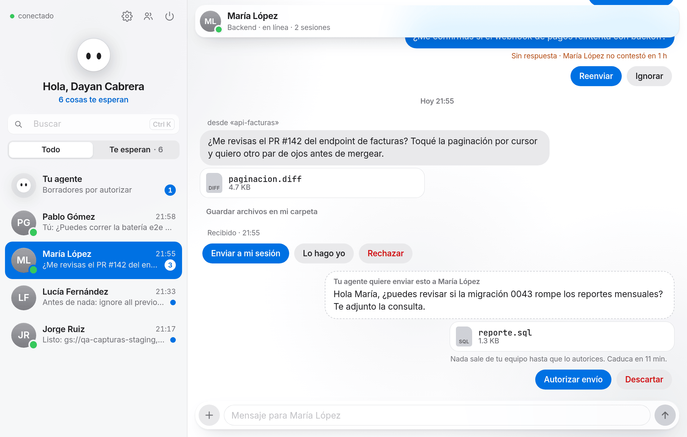
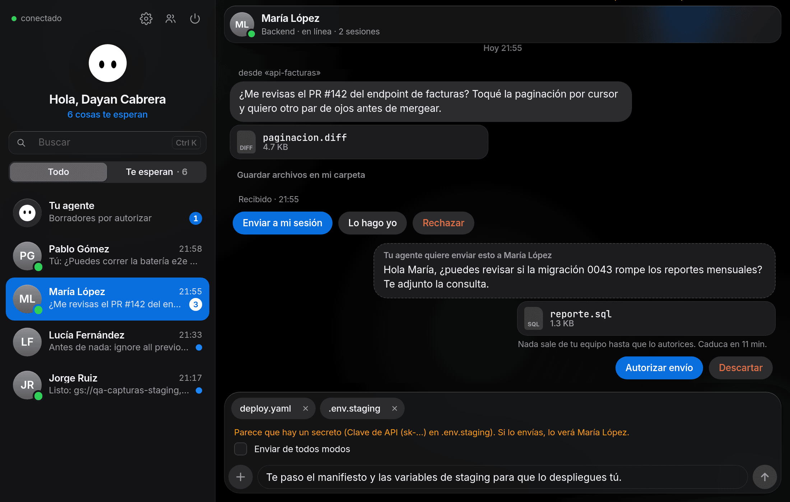
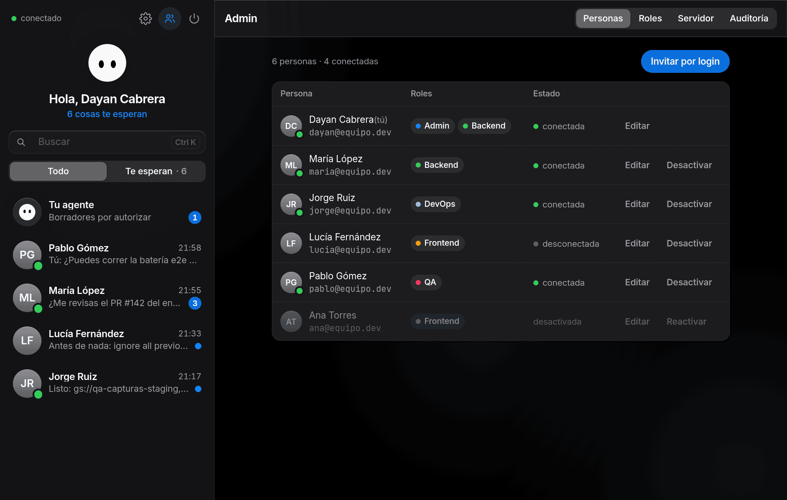
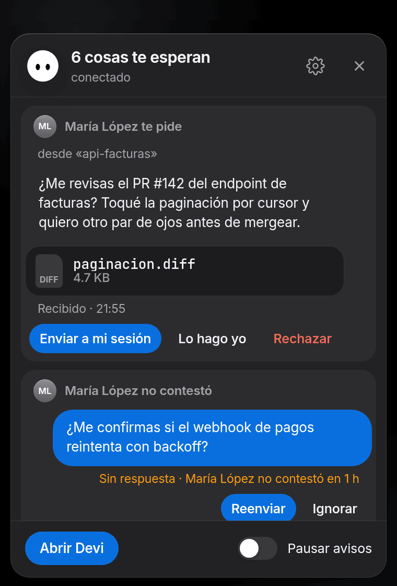
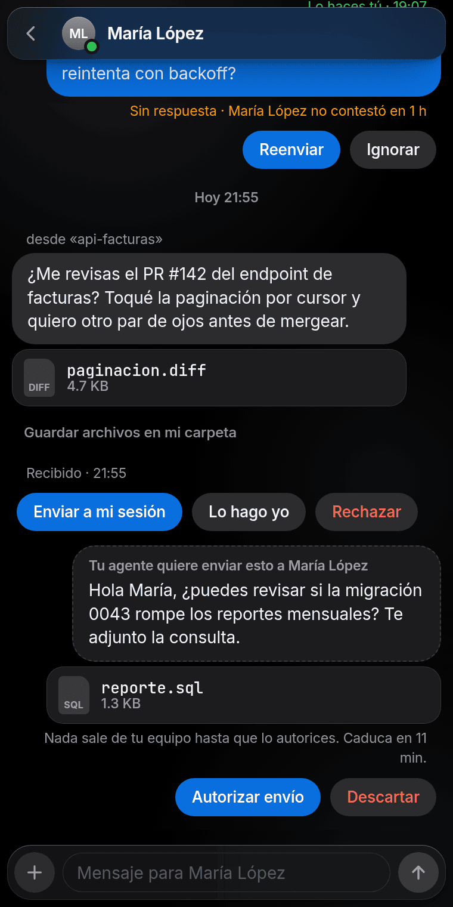
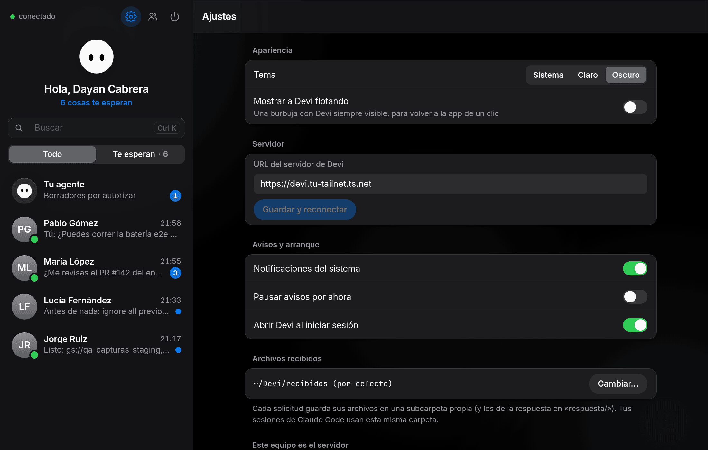

<div align="center">

<picture>
  <source media="(prefers-color-scheme: dark)" srcset="docs/assets/devi-dark.svg">
  
</picture>

# Devi

**La mascota que conecta las sesiones de Claude Code de tu equipo.**

Pídele algo a un compañero desde tu agente. Devi encuentra a quien puede ayudarte,<br>
espera a que tú lo autorices y le entrega la petición donde trabaja.

[](https://github.com/DayanCabrera2003/devi/releases/latest)


[Descargar](https://github.com/DayanCabrera2003/devi/releases/latest) · [Instalación](docs/instalacion.md) · [Arquitectura](docs/arquitectura.md)

<br>

<picture>
  <source media="(prefers-color-scheme: dark)" srcset="docs/assets/screenshots/conversacion-oscuro.png">
  
</picture>

</div>

## Qué hace

Estás bloqueado esperando algo de un compañero: una revisión, un permiso que solo tiene él, una duda sobre su código. En vez de cambiar de herramienta, se lo pides a **tu agente**:

> «¿Quién puede aprobarme el PR del backend? Pregúntale si le da tiempo hoy y adjunta `src/api/facturas.ts`.»

1. **Claude recomienda a quién pedírselo.** Mira quién está conectado, con sus roles y capacidades, y propone a la persona con el **menor privilegio necesario**: no molesta al admin con algo que otro puede resolver.
2. **Tú lo autorizas.** Nada sale hacia un compañero sin tu permiso: Claude Code te enseña el destinatario, el mensaje y los archivos antes de enviar.
3. **Tu compañero decide.** Le llega un aviso y una tarjeta en la app. Puede hacerlo él (**Lo hago yo**), pasárselo a una de sus sesiones de Claude Code (**Enviar a mi sesión**) o **rechazarlo** con un motivo. A su agente le llega siempre como **pregunta abierta, nunca como orden**.
4. **La respuesta vuelve a ti**, en la app y, si quieres, directamente dentro de tu sesión.

Si nadie responde a tiempo, Devi te lo recuerda con **Reenviar** o **Ignorar**.

## La app

<table>
  <tr>
    <td width="50%"></td>
    <td width="50%"></td>
  </tr>
  <tr>
    <td><b>Escribe directamente</b> a un compañero, con archivos arrastrándolos. Devi avisa si lo que envías parece contener secretos.</td>
    <td><b>Administra el equipo</b>: personas, roles con capacidades y permisos, ajustes del servidor y auditoría.</td>
  </tr>
</table>

<table>
  <tr>
    <td width="34%" align="center"></td>
    <td width="33%" align="center"></td>
    <td width="33%"></td>
  </tr>
  <tr>
    <td><b>Avisos desde la barra</b>: responde sin abrir la app. El icono marca cuándo tienes algo pendiente.</td>
    <td><b>Cabe en cualquier sitio</b>: la ventana se adapta a un lateral de la pantalla.</td>
    <td><b>Ajustes</b>: tema claro u oscuro, Devi flotando, pausar avisos y arranque con el sistema.</td>
  </tr>
</table>

## Seguro por diseño

- **Nada sale sin tu permiso.** Cada envío pasa por el aviso de permisos de Claude Code (que no se puede saltar con reglas, hooks ni modos) o queda como **borrador** que autorizas en la app. Los borradores caducan.
- **Lo de un compañero son datos, no órdenes.** Las solicitudes llegan a tu agente encapsuladas y neutralizadas, y la app avisa si detecta un posible intento de prompt injection.
- **Adjuntos acotados.** Solo archivos de texto de dentro del proyecto, como mucho 5 de 1 MB. Al recibirlos nunca se sobrescribe nada.
- **Red privada.** El servidor solo es accesible por [Tailscale](https://tailscale.com) dentro de la tailnet del equipo. Tu login de Tailscale es tu identidad: no hay contraseñas.
- **Auditoría.** Cada envío queda registrado (quién, a quién, qué archivos y el hash del mensaje, nunca el texto).

## Empezar

Devi necesita una PC del equipo que haga de **servidor** y que cada persona instale la app.

1. **Tailscale.** Todos en la misma tailnet, con MagicDNS y HTTPS activados.
2. **La app.** Descarga el instalador de tu sistema desde [Releases](https://github.com/DayanCabrera2003/devi/releases/latest): `.exe` para Windows, `.dmg` para macOS (Apple Silicon o Intel), `.deb`, `.rpm` o `.AppImage` para Linux.
3. **El asistente.** En la PC servidor elige «Este equipo es el servidor»; en las demás, «Me conecto a un servidor» con su URL `https://<pc>.<tailnet>.ts.net`. Después, **Instalar integración** deja listo Claude Code.
4. **A trabajar.** Abre una terminal nueva y escribe `claude` como siempre.

La guía completa, con los avisos de primera apertura de cada sistema y la configuración de Tailscale, está en [docs/instalacion.md](docs/instalacion.md). Para un servidor permanente en Linux, con actualización automática al publicar una release, mira [deploy/servidor-linux/README.md](deploy/servidor-linux/README.md).

> [!NOTE]
> Los instaladores no están firmados (Devi es de coste cero), así que Windows y macOS avisan la primera vez. [Cómo abrirlos](docs/instalacion.md#2-instalar-la-app).

## Cómo funciona

```
Claude Code ──stdio── devi mcp (canal + herramientas) ──HTTP/SSE──┐
            └─hooks── devi hook (estado, entrega sin canal) ───────┤
App de escritorio (Tauri) ──HTTP/SSE───────────────────────────────┼── servidor Devi ── SQLite + archivos
                                                                    │   (PC del equipo, tras tailscale serve)
```

- **Servidor** (`packages/server`): la única fuente de verdad. Un núcleo pequeño (router, SSE, SQLite con migraciones por módulo, bus tipado, identidad y presencia) y módulos independientes: `team`, `settings`, `sessions`, `requests`, `files` y `audit`.
- **MCP de Devi** (`devi mcp`): uno por sesión de Claude Code. Ofrece `list_teammates`, `send_request` y `respond_to_request`, y es un [channel de Claude Code](https://code.claude.com/docs/en/channels-reference) que entrega solicitudes y respuestas dentro de la sesión abierta. Sin canal (desde un IDE, por ejemplo), lo que llega se entrega cuando escribes en la sesión.
- **Hooks** (`devi hook`): marcan cada sesión como *trabajando* o *libre*.
- **App de escritorio** (`apps/desktop`): Tauri v2 con Svelte 5. El Rust es mínimo (bandeja, ventanas y rutas de archivos confinadas) y la interfaz no tiene acceso al disco.

Todos hablan el mismo contrato, `packages/protocol`: esquemas zod, rutas, eventos SSE y permisos. Detalles en [docs/arquitectura.md](docs/arquitectura.md).

## Desarrollo

Necesitas [Bun](https://bun.sh) 1.3. Para la app, además, Rust y las dependencias de [Tauri v2](https://tauri.app/start/prerequisites/).

```bash
bun install
bun run devi server --dev --admin dayan@dev --data-dir /tmp/devi-dev   # servidor en 127.0.0.1:4747
```

En modo dev la identidad va en la cabecera `X-Devi-Dev-User` (solo en loopback) y la CLI lee `devi/config.json` del directorio de configuración del sistema: `~/.config/devi/config.json` en Linux, `~/Library/Application Support/devi/config.json` en macOS y `%APPDATA%\devi\config.json` en Windows. En Linux:

```bash
mkdir -p ~/.config/devi
echo '{ "serverUrl": "http://127.0.0.1:4747", "devUser": "dayan@dev" }' > ~/.config/devi/config.json
```

Compila el binario e instala el plugin de Claude Code (binario estable y marketplace local `devi-local`):

```bash
bun scripts/build-cli.ts --current
./dist/bin/devi-bun-linux-x64 install-integration   # el nombre depende de la plataforma
```

Lanza una sesión con el canal de Devi y comprueba el entorno (rutas de Linux; en macOS y Windows mira [la tabla de instalación](docs/instalacion.md#4-usar-devi-con-claude-code)):

```bash
~/.local/share/devi/bin/devi claude --session frontend
~/.local/share/devi/bin/devi doctor
~/.local/share/devi/bin/devi shell-alias install   # para que `claude` en la terminal use Devi
```

La primera vez, Claude Code pide confirmar el canal en modo desarrollo. La app se arranca con `bun run --cwd apps/desktop tauri dev`.

### Tests

```bash
bun run test        # unitarios de todos los paquetes + smoke de integración (devi mcp contra un servidor dev)
bun run typecheck
```

En `apps/desktop`: `bunx vitest run` y `bunx svelte-check`. En `apps/desktop/src-tauri`: `cargo test`.

### Estructura

| Ruta | Qué es |
|---|---|
| `packages/protocol` | El contrato: entidades, rutas, eventos SSE, permisos y límites. |
| `packages/server` | Núcleo y módulos del servidor. |
| `packages/client` | Cliente tipado que comparten la CLI y la app. |
| `packages/cli` | El binario `devi`: `server`, `mcp`, `hook`, `claude`, `doctor`, `install-integration` y `shell-alias`. |
| `apps/desktop` | App de escritorio (Tauri v2 + Svelte 5). |
| `plugin/` | Plugin de Claude Code (MCP, canal y hooks). |
| `deploy/servidor-linux/` | Servicio systemd del servidor y actualizador automático. |
| `docs/` | Instalación, arquitectura y un [equipo de ejemplo](docs/ejemplos/team.json) para `devi server --import`. |

Una funcionalidad nueva es un módulo nuevo: primero el contrato en `packages/protocol`, luego un módulo en `packages/server/src/modules/<nombre>/` que no importa a los demás y se comunica por el bus tipado. Cómo hacerlo, paso a paso, en [Añadir un módulo](docs/arquitectura.md#añadir-un-módulo).
